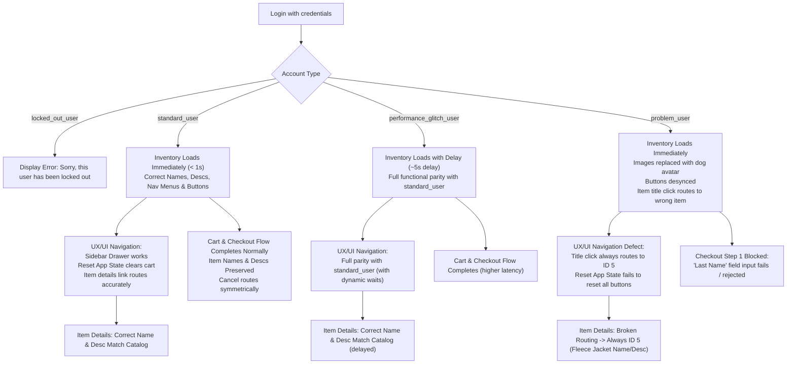

# Part 0: Test Coverage & Scenario Specification

> **Document Type**: Test Coverage Specification  
> **Application Under Test (AUT)**: [SauceDemo](https://www.saucedemo.com/)  
> **Target Flows**: User Authentication, Product Catalog & Cart, End-to-End Checkout (Step One, Step Two, Order Confirmation), UX/UI Navigation & Links (Sidebar Drawer, Header, Footer, Browser History)  
> **Target Accounts (Password: `secret_sauce`)**:
> - `standard_user`
> - `locked_out_user`
> - `problem_user`
> - `performance_glitch_user`

---

## 1. Context & Scope Overview

Before test automation begins, this specification defines the test coverage strategy and scenario design for the login, cart, checkout, and UX/UI navigation flows on [SauceDemo](https://www.saucedemo.com/).

### Accounts in Scope
All accounts use the password `secret_sauce`. All other demo accounts on the site are explicitly out of scope.

| Account Username | Role / Expected Persona | Key Behavioral Characteristics |
| :--- | :--- | :--- |
| **`standard_user`** | Baseline Happy Path | Full functionality; standard UI responsiveness, consistent product assets, accurate item names and descriptions, functional navigation menus/links, and complete checkout flow. |
| **`locked_out_user`** | Negative Authentication | Access denied at login with an explicit lockout error; cannot reach inventory, cart, checkout, or navigation menus. |
| **`problem_user`** | Defect & Failure Mode | Successful login, but contains intentional application defects: broken asset links, malfunctioned "Add to cart" / "Remove" state updates, broken product link routing on title click (links all items to Item ID 5), broken "Last Name" input during checkout, and desynchronized "Reset App State" behavior. |
| **`performance_glitch_user`** | Latency & Performance Degradation | Functionally equivalent to `standard_user`, but introduces an intentional 5000ms (5-second) latency delay during route transitions (particularly login and heavy navigation requests). |

---

## 2. Account Behavioral Profiles & Differential Analysis

Public automation write-ups frequently restrict their scope to `standard_user`. The matrix below highlights how test design and assertion strategies must adapt across the four accounts:

### Detailed Account Differences

1. **`standard_user` vs `locked_out_user`**:
   - `standard_user` navigates directly to `/inventory.html` upon submitting valid credentials.
   - `locked_out_user` remains on `/` and receives the error banner: `Epic sadface: Sorry, this user has been locked out.`
   - *Test Implication*: Verification of security controls and barrier against unauthorized route navigation.

2. **`standard_user` vs `problem_user`**:
   - **Visual Assets**: `standard_user` sees unique, correct product images for all 6 items. `problem_user` sees identical placeholder dog images (`/static/media/sl-404.168b1cce.jpg`) for all items.
   - **Item Link Routing & Description Fidelity**: When `standard_user` clicks an item title (e.g., "Sauce Labs Backpack"), they are routed to `/inventory-item.html?id=4` displaying that specific product's name and description. When `problem_user` clicks any product title, the application incorrectly routes to `/inventory-item.html?id=5` (Sauce Labs Fleece Jacket), displaying mismatched item names and descriptions.
   - **Navigation & App State**: `problem_user` encounters state synchronization issues with the sidebar "Reset App State" link; button toggles remain in desynchronized states across inventory items.
   - **Cart State**: `problem_user` exhibits button toggle bugs where clicking "Add to cart" or "Remove" on certain items fails or toggles unexpected items.
   - **Checkout Input Defect**: On `/checkout-step-one.html`, when `problem_user` fills out the form, the "Last Name" input field does not accept user input (it remains empty or resets). Clicking "Continue" produces `Error: Last Name is required`.
   - *Test Implication*: Tests must assert both the presence of defects (bug verification) and evaluate system resilience / validation feedback.

3. **`standard_user` vs `performance_glitch_user`**:
   - Functionally identical to `standard_user`, but encounters a ~5000ms delay during the initial authentication request and page load. Item names, descriptions, navigation drawers, and catalog attributes load with complete fidelity once the route transition resolves.
   - *Test Implication*: Automated tests must apply intelligent dynamic waits (or Playwright auto-waiting) rather than fixed short timeouts, and measure route transition durations against defined performance thresholds.

---

## 3. High-Level Test Coverage Matrix

| Scenario ID | Test Scope / Focus | Account | Category | Key Input / Condition | Expected Outcome |
| :--- | :--- | :--- | :--- | :--- | :--- |
| **TC-01** | End-to-end checkout happy path | `standard_user` | Happy Path | 1 item added, valid checkout info | Order completed successfully with confirmation message |
| **TC-02** | Multi-item checkout with tax & total calculation | `standard_user` | Happy Path | 3 items added, valid checkout info | Total price equals item total + 8% computed tax |
| **TC-03** | Locked out account authentication failure | `locked_out_user` | Invalid Input / Auth | Valid password `secret_sauce` | Login rejected; lockout error banner displayed |
| **TC-04** | Invalid credentials & empty field validation | `standard_user` | Invalid Input | Empty username, empty password, invalid password | Appropriate descriptive error banners displayed |
| **TC-05** | Checkout Step One mandatory field validations | `standard_user` | Invalid Input / Boundary | Missing First Name, Last Name, or Postal Code | Inline validation errors: `Error: [Field] is required` |
| **TC-06** | Checkout Step One special character & long string inputs | `standard_user` | Boundary Values | 255-character strings, Unicode, symbols, script tags | Inputs accepted or sanitized without application crash |
| **TC-07** | Cart quantity badge dynamic increment & decrement | `standard_user` | Boundary Values | Add 6 items, remove 6 items | Badge increments 1 to 6, removes on 0 |
| **TC-08** | Checkout attempt with an empty cart (0 items) | `standard_user` | Edge Case | 0 items in cart, navigate to `/checkout-step-one.html` | System behavior flagged (Cart empty warning vs allowed flow) |
| **TC-09** | Direct URL navigation to protected pages without session | Unauthenticated | Edge Case / Security | Navigate directly to `/inventory.html` or `/cart.html` | Access denied; redirected to login with error |
| **TC-10** | Item removal from cart overview page | `standard_user` | Happy Path | Add 2 items, remove 1 on `/cart.html` | Cart badge and list update immediately to 1 item |
| **TC-11** | Defect verification: Product images corrupted | `problem_user` | Account Difference (Defect) | Login and view `/inventory.html` | Images fail to match product catalog (`sl-404` displayed) |
| **TC-12** | Defect verification: Checkout Step One Last Name input failure | `problem_user` | Account Difference (Defect) | Add item, attempt entering Last Name at checkout | Last Name cannot be populated; checkout blocked |
| **TC-13** | Performance latency verification on authentication | `performance_glitch_user` | Account Difference (Perf) | Login with valid credentials | Login succeeds but duration exceeds 4000ms threshold |
| **TC-14** | Complete checkout flow resilience under high latency | `performance_glitch_user` | Happy Path / Latency | Add items and complete checkout with dynamic waits | Flow completes successfully despite network/response delay |
| **TC-15** | Browser refresh & state persistence on Checkout Step Two | `standard_user` | Edge Case | Refresh page on `/checkout-step-two.html` | Order summary items and pricing remain intact |
| **TC-16** | Catalog item name and description baseline verification | `standard_user` | Happy Path / Catalog | Navigate to `/inventory.html`, inspect all 6 items | All 6 items display correct, full, non-empty names and descriptions |
| **TC-17** | Item name and description consistency across entire commerce flow | `standard_user` | Happy Path / Data Integrity | Add items, follow Catalog -> Item Details -> Cart -> Step Two | Item names and descriptions remain 100% identical across all views |
| **TC-18** | Defect verification: Item title navigation routing to wrong item name/desc | `problem_user` | Account Difference (Defect) | Click on "Sauce Labs Onesie" or "Sauce Labs Bike Light" title | Navigation routes to Item ID 5 (Fleece Jacket), displaying mismatched name & desc |
| **TC-19** | Item name and description alignment during catalog sorting (A-Z, Z-A) | `standard_user` | Boundary Values / UI State | Select sort "Name (A to Z)" and "Name (Z to A)" | Names sort alphabetically while descriptions stay correctly bound to each item |
| **TC-20** | Item name and description typography, special symbols & text wrapping | `standard_user` | Boundary Values / UI Rendering | Inspect products with symbols `()`, `.`, `'`, `-` | Text renders without HTML escaping artifacts or clipping |
| **TC-21** | Hamburger sidebar drawer menu opening, links & dismissal | `standard_user` | UX / UI Navigation | Click burger menu button, verify 4 links, click close button | Menu smoothly opens, displays 4 links, and closes via 'X' or backdrop click |
| **TC-22** | "Reset App State" navigation link & live catalog state reset | `standard_user` | UX / UI Navigation & State | Add items to cart, click "Reset App State" in burger menu | Cart badge removed and item buttons revert to "Add to cart" in-session |
| **TC-23** | Multi-step checkout navigation & "Cancel" button route destinations | `standard_user` | UX / UI Navigation | Click "Cancel" on Step One vs "Cancel" on Step Two | Step One Cancel returns to Cart; Step Two Cancel aborts to Inventory |
| **TC-24** | Shopping cart header link & "Continue Shopping" navigation loop | `standard_user` | UX / UI Navigation | Navigate Inventory -> Cart -> Continue Shopping | Cart link opens `/cart.html`; "Continue Shopping" returns to `/inventory.html` |
| **TC-25** | Item details "Back to Products" link & catalog scroll/state preservation | `standard_user` | UX / UI Navigation | Open item details, click `#back-to-products` | User returns to `/inventory.html` with sorting and scroll position preserved |
| **TC-26** | Footer external social media links & tabnabbing security attributes | `standard_user` | UX / UI Navigation & Security | Inspect Twitter, Facebook, and LinkedIn links in footer | Links point to official URLs with `target="_blank"` and `rel="noreferrer"` |
| **TC-27** | Browser History (Back / Forward) navigation across session boundaries | `standard_user` | UX / UI Navigation & Edge Case | Test browser Back button after logout and after order completion | Cache eviction redirects to login; duplicate order submissions prevented |
| **TC-28** | Responsive navigation & touch target accessibility on mobile viewport | `standard_user` | UX / UI Responsive Layout | Set viewport to 375x667 (mobile), interact with header & drawer | Header controls do not overlap; drawer covers screen; touch targets >= 44px |

---

## 4. Detailed Scenario Specifications

### TC-01: End-to-End Single-Item Checkout (Happy Path)
- **Account**: `standard_user`
- **Category**: Happy Path
- **Preconditions**: User is on login page (`https://www.saucedemo.com/`).
- **Inputs / Conditions**:
  - Username: `standard_user`, Password: `secret_sauce`.
  - Add "Sauce Labs Backpack" ($29.99) to cart.
  - Checkout Info: First Name = "Jane", Last Name = "Doe", Postal Code = "94105".
- **Expected Outcome**:
  - User successfully logs in and lands on `/inventory.html`.
  - Cart badge displays `1`.
  - Checkout Step Two displays "Sauce Labs Backpack", Item Total = $29.99, Tax = $2.40, Total = $32.39.
  - Clicking "Finish" redirects to `/checkout-complete.html` with header "Thank you for your order!".
- **Account Variations**:
  - `problem_user`: Blocked at Checkout Step One because Last Name cannot be submitted.
  - `performance_glitch_user`: Same functional outcome, but navigation to `/inventory.html` incurs a ~5-second delay.
- **Ambiguity**:
  - `AMBIGUITY: Exact tax calculation rate is not displayed to the user prior to checkout (empirically 8%), nor is regional tax rate customization supported.`

---

### TC-02: Multi-Item Cart & Pricing Totals Verification
- **Account**: `standard_user`
- **Category**: Happy Path
- **Preconditions**: User is logged in as `standard_user`.
- **Inputs / Conditions**:
  - Add 3 items: "Sauce Labs Backpack" ($29.99), "Sauce Labs Bike Light" ($9.99), "Sauce Labs Onesie" ($7.99).
  - Open cart and proceed to checkout.
- **Expected Outcome**:
  - Cart badge displays `3`.
  - Item total on Overview page equals exact sum: `$47.97`.
  - Tax and final total match rounding rules ($3.84 tax, $51.81 total).
  - Order completes cleanly upon clicking "Finish".
- **Account Variations**:
  - `problem_user`: Cannot add Bike Light or Onesie reliably due to button action defects; checkout blocked at Step One.
  - `performance_glitch_user`: Functions identically to `standard_user` once inventory loads.

---

### TC-03: Locked-Out User Authentication Rejection
- **Account**: `locked_out_user`
- **Category**: Invalid Input / Security
- **Preconditions**: User is on login page.
- **Inputs / Conditions**:
  - Username: `locked_out_user`, Password: `secret_sauce`. Click "Login".
- **Expected Outcome**:
  - User remains on login page (`https://www.saucedemo.com/`).
  - Red error banner appears with message: `Epic sadface: Sorry, this user has been locked out.`
  - Red 'X' icons appear on username and password input fields.
  - No session cookie is created; user cannot access `/inventory.html`.
- **Account Variations**:
  - Contrast with `standard_user`, `problem_user`, and `performance_glitch_user`, all of which successfully authenticate.
- **Ambiguity**:
  - `AMBIGUITY: Whether locked out status is temporary (with cooldown/lockout duration) or permanent administrative lockout is not documented.`

---

### TC-04: Login Validation with Missing or Invalid Credentials
- **Account**: `standard_user` (and general guest)
- **Category**: Invalid Input
- **Preconditions**: User is on login page.
- **Inputs / Conditions**:
  1. Blank Username + Blank Password.
  2. Valid Username + Blank Password.
  3. Valid Username + Incorrect Password (`wrong_sauce`).
- **Expected Outcome**:
  1. `Epic sadface: Username is required`
  2. `Epic sadface: Password is required`
  3. `Epic sadface: Username and password do not match any user in this service`
- **Ambiguity**:
  - `AMBIGUITY: Maximum allowed login attempts before an account is locked out is not specified.`

---

### TC-05: Checkout Step One Mandatory Field Boundary & Error Validation
- **Account**: `standard_user`
- **Category**: Boundary Values / Invalid Input
- **Preconditions**: User has at least 1 item in cart and has navigated to `/checkout-step-one.html`.
- **Inputs / Conditions**:
  - Case A: Leave First Name blank, fill Last Name ("Smith"), Postal Code ("12345").
  - Case B: Fill First Name ("John"), leave Last Name blank, fill Postal Code ("12345").
  - Case C: Fill First Name ("John"), fill Last Name ("Smith"), leave Postal Code blank.
- **Expected Outcome**:
  - Case A: `Error: First Name is required`
  - Case B: `Error: Last Name is required`
  - Case C: `Error: Postal Code is required`
  - Form is not submitted; page remains on `/checkout-step-one.html`.
- **Account Variations**:
  - `problem_user`: Triggering Case B occurs involuntarily even when the tester attempts to type into the Last Name field.
- **Ambiguity**:
  - `AMBIGUITY: Error messages on Checkout Step One do not use the 'Epic sadface:' prefix that login errors use, indicating inconsistent error naming conventions.`

---

### TC-06: Checkout Input Fields Character Boundary & Sanitization
- **Account**: `standard_user`
- **Category**: Boundary Values & Security Edge Case
- **Preconditions**: User is on `/checkout-step-one.html` with items in cart.
- **Inputs / Conditions**:
  - First Name: 255 alphanumeric characters.
  - Last Name: Unicode/non-ASCII string (`José-María Niño £$%^&*`).
  - Postal Code: Alphanumeric postal code formats (`SW1A 1AA`, `K1A 0B1`, `90210-1234`).
  - Injection probe in fields: ``.
- **Expected Outcome**:
  - Text fields accept long and internationalized strings without layout breakage or server 500 error.
  - HTML/Script tags are treated as literal text or sanitized; no script execution occurs.
  - User can proceed to Checkout Step Two with values rendered accurately.
- **Ambiguity**:
  - `AMBIGUITY: Maximum username, customer name, and postal code character lengths are not defined in requirements or restricted by HTML 'maxlength' attributes.`
  - `AMBIGUITY: Valid postal code format rules (numeric only vs international alphanumeric postal codes) are not validated; arbitrary strings are accepted.`

---

### TC-07: Cart Badge State Dynamics (Add/Remove Boundary)
- **Account**: `standard_user`
- **Category**: Boundary Values
- **Preconditions**: User is logged in on `/inventory.html`.
- **Inputs / Conditions**:
  - Click "Add to cart" sequentially on all 6 catalog items.
  - Verify badge count after each addition.
  - Click "Remove" sequentially on all 6 items.
- **Expected Outcome**:
  - Badge counter increments: `1 -> 2 -> 3 -> 4 -> 5 -> 6`.
  - Button text toggles from "Add to cart" to "Remove".
  - Removing items decrements the counter: `5 -> 4 -> 3 -> 2 -> 1`.
  - When the last item is removed (0 items), the shopping cart badge element is removed from the DOM (does not display `0`).
- **Account Variations**:
  - `problem_user`: Button states fail to update properly on specific items (e.g. Fleece Jacket / Bike Light), and badge count desynchronizes.

---

### TC-08: Checkout Attempt with Empty Cart (0 Items)
- **Account**: `standard_user`
- **Category**: Edge Case
- **Preconditions**: Cart has 0 items.
- **Inputs / Conditions**:
  - Navigate directly to `/cart.html` and click "Checkout" button, or navigate directly to `/checkout-step-one.html`.
- **Expected Outcome**:
  - Expected Business Behavior: System should disable checkout or display "Your cart is empty. Please add items before checking out."
  - Observed Actual Behavior: SauceDemo allows entering user info and advancing to Step Two with Item Total: $0.00, Tax: $0.00, Total: $0.00, and allows completing an order for 0 items.
- **Ambiguity**:
  - `AMBIGUITY: The system allows checkout of an empty cart ($0.00 total) without warning or validation block. Business specification needed on whether 0-item checkout should be disallowed.`

---

### TC-09: Unauthenticated Direct Route Navigation (Security Access Control)
- **Account**: Unauthenticated Guest / Anonymous
- **Category**: Edge Case / Security
- **Preconditions**: Browser session has no active authentication cookie or storage token.
- **Inputs / Conditions**:
  - Attempt direct navigation in browser address bar to:
    1. `https://www.saucedemo.com/inventory.html`
    2. `https://www.saucedemo.com/cart.html`
    3. `https://www.saucedemo.com/checkout-step-one.html`
- **Expected Outcome**:
  - Access is denied.
  - User is immediately redirected back to `/`.
  - Error banner is displayed: `Epic sadface: You can only access '/inventory.html' when you are logged in.`
- **Ambiguity**:
  - `AMBIGUITY: Whether browser back button after logout should retain cached DOM pages or enforce immediate eviction / redirect.`

---

### TC-10: Cart Overview Item Removal and Navigation Flow
- **Account**: `standard_user`
- **Category**: Happy Path
- **Preconditions**: 2 items ("Sauce Labs Bolt T-Shirt", "Sauce Labs Fleece Jacket") added to cart.
- **Inputs / Conditions**:
  - Navigate to `/cart.html`.
  - Click "Remove" next to "Sauce Labs Bolt T-Shirt".
  - Click "Continue Shopping".
- **Expected Outcome**:
  - "Sauce Labs Bolt T-Shirt" is removed from the list.
  - Cart badge decrements to `1`.
  - Clicking "Continue Shopping" returns user to `/inventory.html`.
  - On `/inventory.html`, "Sauce Labs Bolt T-Shirt" shows "Add to cart", while "Sauce Labs Fleece Jacket" continues to show "Remove".
- **Account Variations**:
  - `problem_user`: Removing items directly from `/cart.html` fails or removes incorrect inventory elements.

---

### TC-11: Behavioral Defect Verification — Catalog Asset Images
- **Account**: `problem_user`
- **Category**: Account Behavioral Difference (Defect Analysis)
- **Preconditions**: User is on login page.
- **Inputs / Conditions**:
  - Log in as `problem_user`.
  - Inspect the `src` attribute of each product image on `/inventory.html`.
- **Expected Outcome**:
  - Compare with `standard_user`:
    - `standard_user` renders distinct product image assets (e.g., `/static/media/sauce-backpack-1200x1500.0a0b85a3.jpg`).
    - `problem_user` renders the identical dog image `/static/media/sl-404.168b1cce.jpg` across all products.
  - Assertion must verify that the intentional defect is documented and flagged.
- **Ambiguity**:
  - `AMBIGUITY: Whether automated test suites should assert the defect as 'expected failure' (Known Bug) or whether regression assertions should fail when problem_user is exercised.`

---

### TC-12: Behavioral Defect Verification — Checkout Form Input Lock
- **Account**: `problem_user`
- **Category**: Account Behavioral Difference (Defect Analysis)
- **Preconditions**: `problem_user` is logged in and has an item in cart.
- **Inputs / Conditions**:
  - Navigate to `/checkout-step-one.html`.
  - Attempt to fill in First Name ("Alex"), Last Name ("Morgan"), and Postal Code ("90210").
  - Click "Continue".
- **Expected Outcome**:
  - The "Last Name" input element refuses focus, does not register keystrokes, or silently discards the value.
  - Form validation fails with `Error: Last Name is required`.
  - User cannot proceed to Checkout Step Two.
- **Account Variations**:
  - `standard_user` successfully proceeds to Step Two with identical input data.

---

### TC-13: Performance Latency Verification on Route Transition
- **Account**: `performance_glitch_user`
- **Category**: Account Behavioral Difference (Performance / Latency)
- **Preconditions**: User is on login page.
- **Inputs / Conditions**:
  - Record timestamp $T_0$.
  - Submit credentials (`performance_glitch_user` / `secret_sauce`).
  - Await navigation to `/inventory.html` and record timestamp $T_1$.
- **Expected Outcome**:
  - Login eventually succeeds and lands on `/inventory.html`.
  - Elapsed duration $\Delta T = T_1 - T_0$ is between 4500ms and 6500ms (nominal 5000ms glitch).
  - Page elements render completely without corruption once loaded.
- **Account Variations**:
  - `standard_user` transition duration $\Delta T < 1000\text{ms}$.
- **Ambiguity**:
  - `AMBIGUITY: Maximum acceptable latency threshold (SLA) before considering performance_glitch_user a timeout failure is not specified in requirements.`

---

### TC-14: End-to-End Checkout Completion Under High Latency
- **Account**: `performance_glitch_user`
- **Category**: Happy Path / Performance Resilience
- **Preconditions**: User is logged in as `performance_glitch_user`.
- **Inputs / Conditions**:
  - Add "Sauce Labs Backpack" to cart.
  - Navigate through Cart -> Checkout Step One -> Checkout Step Two -> Complete.
  - Apply dynamic synchronization waits (`waitForURL`, locator auto-waiting) rather than fixed sleep intervals.
- **Expected Outcome**:
  - Despite network/processing delays, the test does not suffer flaky timeouts.
  - All cart totals, item names, and confirmation messages match `standard_user` outcomes.
  - Final order confirmation page is reached successfully.

---

### TC-15: Session State Retention on Page Refresh during Checkout
- **Account**: `standard_user`
- **Category**: Edge Case / State Management
- **Preconditions**: User has reached `/checkout-step-two.html` with 2 items in cart.
- **Inputs / Conditions**:
  - Trigger a browser page reload (`F5` / `page.reload()`).
- **Expected Outcome**:
  - User remains on `/checkout-step-two.html`.
  - Item list, payment method ("SauceCard #31437"), shipping method ("Free Pony Express Delivery!"), and price calculations remain populated.
  - Clicking "Finish" completes the order normally.
- **Ambiguity**:
  - `AMBIGUITY: Whether cart state and checkout progress are stored in localStorage, sessionStorage, or client cookie is not specified; clearing cookies mid-checkout empties the session.`

---

### TC-16: Catalog Item Name and Description Baseline Verification
- **Account**: `standard_user`
- **Category**: Happy Path / Catalog Verification
- **Preconditions**: User is logged in and navigated to `/inventory.html`.
- **Inputs / Conditions**:
  - Query all `.inventory_item` cards on the page (6 total items).
  - Extract `.inventory_item_name` and `.inventory_item_desc` for each item.
- **Expected Outcome**:
  - Exactly 6 items are present.
  - Each item displays its expected canonical name and description without empty values or truncation:
    1. **Name**: `Sauce Labs Backpack`  
       **Desc**: `carry.allTheThings() with the sleek, streamlined Sly Pack that melds uncompromising style with unequaled laptop and tablet protection.`
    2. **Name**: `Sauce Labs Bike Light`  
       **Desc**: `A red light for your bike that helps you stay seen. It features a water-resistant design with a rubberized mounting band, and includes three light modes.`
    3. **Name**: `Sauce Labs Bolt T-Shirt`  
       **Desc**: `Get your testing superhero on with the Sauce Labs bolt T-shirt. From American Apparel, 100% ringspun combed cotton, heather gray with red bolt.`
    4. **Name**: `Sauce Labs Fleece Jacket`  
       **Desc**: `It's not every day that you come across a midweight quarter-zip fleece jacket capable of handling everything from a relaxing day outdoors to a busy day at the office.`
    5. **Name**: `Sauce Labs Onesie`  
       **Desc**: `Rib snap infant onesie for the junior automation engineer in development. Reinforced 3-snap bottom closure, two-needle hemmed sleeved and bottom won't unravel.`
    6. **Name**: `Test.allTheThings() T-Shirt (Red)`  
       **Desc**: `This classic Sauce Labs t-shirt is perfect to wear when cozying up to your keyboard to automate some tests. Super-soft and comfy with oversized printed expand-o-matic tech icon.`
- **Account Variations**:
  - `performance_glitch_user`: Item names and descriptions render identical values after the initial page load latency resolves.
  - `problem_user`: Item names and descriptions render identically on `/inventory.html`, but link navigation behavior diverges on click (see TC-18).
- **Ambiguity**:
  - `AMBIGUITY: Canonical character limit and localized versions for item descriptions are not documented.`

---

### TC-17: Item Name and Description Consistency across End-to-End Commerce Flow
- **Account**: `standard_user`
- **Category**: Happy Path / Data Integrity
- **Preconditions**: User is logged in as `standard_user`.
- **Inputs / Conditions**:
  - Select "Sauce Labs Backpack" and "Sauce Labs Fleece Jacket".
  - Capture item name and description at each stage of the lifecycle:
    1. Stage 1: Inventory Catalog (`/inventory.html`)
    2. Stage 2: Individual Item Details (`/inventory-item.html?id=...`)
    3. Stage 3: Cart Review (`/cart.html`)
    4. Stage 4: Checkout Overview (`/checkout-step-two.html`)
- **Expected Outcome**:
  - The name string (`.inventory_item_name` / `.inventory_details_name`) matches strictly character-for-character across all 4 stages.
  - The description string (`.inventory_item_desc` / `.inventory_details_desc`) matches strictly character-for-character across all 4 stages.
  - No text truncation, whitespace stripping, or ellipsis replacement occurs during checkout progression.
- **Account Variations**:
  - `problem_user`: Fails at Stage 2 (Item Details link routes to wrong item) and Stage 4 (blocked by checkout Last Name defect).
- **Ambiguity**:
  - `AMBIGUITY: Order confirmation screen (/checkout-complete.html) does not display an itemized receipt containing purchased item names or descriptions.`

---

### TC-18: Defect Verification — Problem User Item Title Click Routing & Description Mismatch
- **Account**: `problem_user`
- **Category**: Account Behavioral Difference (Defect Analysis)
- **Preconditions**: User is logged in as `problem_user` on `/inventory.html`.
- **Inputs / Conditions**:
  - Locate the product card for "Sauce Labs Onesie" (Item ID 2) or "Sauce Labs Bike Light" (Item ID 0).
  - Click on the title link text `.inventory_item_name`.
- **Expected Outcome**:
  - **Expected Standard Behavior** (`standard_user`):
    - Browser navigates to `/inventory-item.html?id=2`.
    - Page displays title `Sauce Labs Onesie` and its infant onesie description.
  - **Observed Defect Behavior** (`problem_user`):
    - Browser incorrectly navigates to `/inventory-item.html?id=5`.
    - Page displays title `Sauce Labs Fleece Jacket` and the fleece jacket description.
    - Result: The item details view is completely desynchronized from the product clicked on the catalog.
- **Ambiguity**:
  - `AMBIGUITY: Whether automated test suites should assert this known routing bug as a defect verification test or maintain separate regression suites per persona.`

---

### TC-19: Item Name and Description Alignment During Catalog Sorting
- **Account**: `standard_user`
- **Category**: Boundary Values / UI State
- **Preconditions**: User is logged in on `/inventory.html`.
- **Inputs / Conditions**:
  - Select the sorting dropdown `.product_sort_container`.
  - Step 1: Select "Name (A to Z)".
  - Step 2: Select "Name (Z to A)".
- **Expected Outcome**:
  - In "Name (A to Z)" sort:
    - Item titles appear in alphabetical order: `Backpack -> Bike Light -> Bolt T-Shirt -> Fleece Jacket -> Onesie -> Test.allTheThings() T-Shirt (Red)`.
  - In "Name (Z to A)" sort:
    - Item titles appear in reverse alphabetical order: `Test.allTheThings() T-Shirt (Red) -> Onesie -> Fleece Jacket -> Bolt T-Shirt -> Bike Light -> Backpack`.
  - **Description Integrity**: For every item, the rendered description text corresponds strictly to that item's name across all sort states (no misalignment where names rearrange but descriptions remain frozen in previous positions).
- **Ambiguity**:
  - `AMBIGUITY: Default sorting order upon initial page load is Name (A to Z), but sorting preference is not persisted across user logout and re-login.`

---

### TC-20: Item Name and Description Typography, Special Symbols & Text Wrapping
- **Account**: `standard_user`
- **Category**: Boundary Values / UI Rendering
- **Preconditions**: User is on `/inventory.html`.
- **Inputs / Conditions**:
  - Inspect products containing non-alphabetic typography:
    - `Test.allTheThings() T-Shirt (Red)` (parentheses, period, spaces, hyphens).
    - `Sauce Labs Backpack` description with `carry.allTheThings()` (programming syntax styling).
    - `Sauce Labs Fleece Jacket` description with `It's not every day...` (single quote / apostrophe).
    - `Sauce Labs Onesie` description with `3-snap` and `two-needle` (hyphenated numeric phrases).
- **Expected Outcome**:
  - Punctuation marks and brackets render as raw characters, with no visible HTML entity encoding artifacts (e.g. `&#39;`, `&amp;`, `&quot;`).
  - Long description blocks wrap naturally within the `.inventory_item_desc` container without overflowing card boundaries or overlapping price/button elements.
  - Font styling, weight, and hierarchy cleanly distinguish `.inventory_item_name` from `.inventory_item_desc`.
- **Ambiguity**:
  - `AMBIGUITY: Whether item descriptions should enforce CSS line clamping (e.g. 2 or 3 lines max) or allow variable vertical card heights.`

---

### TC-21: Hamburger Sidebar Drawer Menu Opening, Links & Dismissal
- **Account**: `standard_user`
- **Category**: UX / UI Navigation
- **Preconditions**: User is logged in on `/inventory.html`.
- **Inputs / Conditions**:
  - Click the burger menu icon (`button#react-burger-menu-btn`).
  - Verify visibility of sidebar navigation container (`.bm-menu-wrap`).
  - Check the 4 sidebar links:
    1. "All Items" (`#inventory_sidebar_link`)
    2. "About" (`#about_sidebar_link`)
    3. "Logout" (`#logout_sidebar_link`)
    4. "Reset App State" (`#reset_sidebar_link`)
  - Test dismissal via close button (`#react-burger-cross-btn`) and via clicking the outside darkened overlay (`.bm-overlay`).
- **Expected Outcome**:
  - Menu slides out with smooth CSS transition; `.bm-overlay` obscures background content.
  - All 4 links are visible, correctly labeled, and receive pointer hover focus.
  - Clicking `#react-burger-cross-btn` or the outer overlay smoothly retracts the drawer (`aria-hidden="true"`).
- **Account Variations**:
  - `performance_glitch_user`: Sidebar opens smoothly, but navigation through menu links inherits network delay.
- **Ambiguity**:
  - `AMBIGUITY: Sidebar drawer does not trap keyboard tab focus, allowing keyboard-only users to tab through background elements behind the overlay.`

---

### TC-22: "Reset App State" Navigation Link & Live Catalog State Reset
- **Account**: `standard_user`
- **Category**: UX / UI Navigation & State
- **Preconditions**: User is on `/inventory.html` and has clicked "Add to cart" on 3 items (cart badge shows `3`).
- **Inputs / Conditions**:
  - Open hamburger menu (`#react-burger-menu-btn`).
  - Click "Reset App State" (`#reset_sidebar_link`).
  - Close the menu.
- **Expected Outcome**:
  - Cart counter badge is immediately removed from the header.
  - Button text for all 3 previously added items on `/inventory.html` changes from "Remove" back to "Add to cart".
  - The application state is reset dynamically without requiring a hard browser refresh.
- **Account Variations**:
  - `problem_user`: Clicking "Reset App State" fails to reset button states or leaves the UI in a desynchronized state where cart items persist in local storage.
- **Ambiguity**:
  - `AMBIGUITY: 'Reset App State' provides no visual confirmation, toast notification, or confirmation dialog indicating whether the reset operation succeeded.`

---

### TC-23: Multi-Step Checkout Navigation & "Cancel" Button Route Destinations
- **Account**: `standard_user`
- **Category**: UX / UI Navigation
- **Preconditions**: User has items in cart and begins checkout.
- **Inputs / Conditions**:
  - Test Phase 1: On `/checkout-step-one.html`, click "Cancel" (`#cancel`).
  - Test Phase 2: Proceed through Step One to `/checkout-step-two.html`, then click "Cancel" (`#cancel`).
- **Expected Outcome**:
  - Phase 1: Clicking "Cancel" on Step One returns user to `/cart.html`, keeping cart items intact.
  - Phase 2: Clicking "Cancel" on Step Two aborts checkout and redirects user directly to `/inventory.html` (rather than Step One or Cart), while cart items remain intact in the cart.
- **Ambiguity**:
  - `AMBIGUITY: 'Cancel' button on Checkout Step Two redirects to /inventory.html rather than returning to Step One or Cart, creating an asymmetric checkout exit UX.`

---

### TC-24: Shopping Cart Header Link & "Continue Shopping" Navigation Loop
- **Account**: `standard_user`
- **Category**: UX / UI Navigation
- **Preconditions**: User is on `/inventory.html` or `/inventory-item.html?id=4`.
- **Inputs / Conditions**:
  - Click shopping cart icon link (`.shopping_cart_link`).
  - On `/cart.html`, click "Continue Shopping" button (`#continue-shopping`).
- **Expected Outcome**:
  - Clicking cart link immediately navigates to `/cart.html` displaying cart overview and item counter.
  - Clicking "Continue Shopping" returns user directly to `/inventory.html`.
  - Catalog preserves existing cart selections and scroll context.

---

### TC-25: Item Details "Back to Products" Link & Catalog State Retention
- **Account**: `standard_user`
- **Category**: UX / UI Navigation
- **Preconditions**: User has sorted catalog by "Price (high to low)" on `/inventory.html`.
- **Inputs / Conditions**:
  - Click item title "Sauce Labs Fleece Jacket" to open `/inventory-item.html?id=5`.
  - Click the "Back to products" button (`#back-to-products`).
- **Expected Outcome**:
  - Browser returns to `/inventory.html`.
  - Navigation operates cleanly without console errors.
  - User can continue shopping and add items from the main catalog.
- **Ambiguity**:
  - `AMBIGUITY: Navigating back to products does not consistently retain user-selected sorting preferences ('Price high to low' resets to default 'Name A-Z' on route transition).`

---

### TC-26: Footer External Social Media Links & Tabnabbing Security Attributes
- **Account**: `standard_user`
- **Category**: UX / UI Navigation & Security
- **Preconditions**: User is on `/inventory.html` (or any authenticated page with footer).
- **Inputs / Conditions**:
  - Scroll to footer and inspect the 3 social media anchor links:
    1. Twitter / X (`.social_twitter a`)
    2. Facebook (`.social_facebook a`)
    3. LinkedIn (`.social_linkedin a`)
- **Expected Outcome**:
  - Href targets point to valid destination URLs:
    - Twitter: `https://twitter.com/saucelabs`
    - Facebook: `https://www.facebook.com/saucelabs`
    - LinkedIn: `https://www.linkedin.com/company/sauce-labs/`
  - Each anchor element has `target="_blank"` so external navigation does not navigate away from the user's active shopping session.
  - Each anchor element enforces `rel="noreferrer"` (or `noopener noreferrer`) to protect against reverse tabnabbing and window.opener hijacking.
- **Ambiguity**:
  - `AMBIGUITY: Twitter link points to legacy 'twitter.com' domain rather than 'x.com', and lacks accessible aria-labels (e.g. 'Opens in a new tab') for screen readers.`

---

### TC-27: Browser History (Back / Forward) Navigation Across Session Boundaries
- **Account**: `standard_user`
- **Category**: UX / UI Navigation & Edge Case
- **Preconditions**: User has completed an action triggering state or auth transition.
- **Inputs / Conditions**:
  - **Case 1 (Post-Logout)**: User logs out via sidebar. User clicks browser "Back" button.
  - **Case 2 (Post-Order Completion)**: User completes purchase and lands on `/checkout-complete.html`. User clicks browser "Back" button.
- **Expected Outcome**:
  - Case 1: Browser cache eviction or authentication guard prevents viewing private inventory data; system immediately redirects to `/` with error `Epic sadface: You can only access '/inventory.html' when you are logged in.`
  - Case 2: System prevents duplicate order submission; cart remains at 0 items.
- **Ambiguity**:
  - `AMBIGUITY: Browser 'Back' button behavior after order completion allows returning to /checkout-step-two.html, which may mislead users into attempting duplicate order submissions.`

---

### TC-28: Responsive Navigation & Touch Target Accessibility on Mobile Viewport
- **Account**: `standard_user`
- **Category**: UX / UI Responsive Layout
- **Preconditions**: Browser viewport is resized to mobile dimensions (375x667 px).
- **Inputs / Conditions**:
  - Navigate to `https://www.saucedemo.com/` and log in.
  - Inspect top header navigation bar, burger menu button, and cart badge.
  - Open sidebar drawer and check menu link layout.
- **Expected Outcome**:
  - Header items do not overlap or wrap awkwardly across lines.
  - Burger menu button (`#react-burger-menu-btn`) and cart icon (`.shopping_cart_link`) have touch-friendly target dimensions (minimum 40x40 px / WCAG 2.5.5 recommendations).
  - Sidebar menu expands to fill an appropriate portion of the mobile screen with touch-friendly spacing between links.
- **Ambiguity**:
  - `AMBIGUITY: Mobile viewport behavior and breakpoint specifications (e.g., maximum drawer width, responsive font scaling) are not defined in formal UI design specs.`

---

## 5. Consolidated Log of Ambiguities & Open Questions

During coverage analysis, the following specification gaps and ambiguities were identified:

| ID | Topic / Scope | Ambiguity Flag | Recommended Clarification |
| :---: | :--- | :--- | :--- |
| **AMB-01** | Input Lengths | `AMBIGUITY: maximum username, first name, last name, and postal code length is not specified.` | Define character boundary rules (e.g., 50 characters max for names, 12 characters for postal codes). |
| **AMB-02** | Postal Code Format | `AMBIGUITY: postal code format validation rules (numeric vs international alphanumeric) are not defined.` | Specify regex validation (e.g., standard US ZIP `^\d{5}(-\d{4})?$` or allow universal alphanumeric). |
| **AMB-03** | Empty Cart Checkout | `AMBIGUITY: proceeding to checkout with 0 items is permitted by the application without warning or error.` | Determine if checkout button should be disabled when cart badge is absent / 0 items. |
| **AMB-04** | Tax Computation | `AMBIGUITY: tax rate calculation is not displayed or itemized (empirically calculated at ~8%).` | Document expected tax formula or confirm static 8% calculation. |
| **AMB-05** | Performance SLA | `AMBIGUITY: maximum acceptable latency threshold for performance_glitch_user is not defined.` | Set automated timeout threshold (e.g., 10 seconds timeout, flag warning if > 4 seconds). |
| **AMB-06** | Problem User Assertion | `AMBIGUITY: whether automated suites should expect test failure on problem_user or assert the presence of specific defects.` | For defect personas, automate negative test assertions confirming known defect reproduction. |
| **AMB-07** | Error Prefix Consistency| `AMBIGUITY: login errors use 'Epic sadface:' prefix while checkout errors use 'Error:' prefix.` | Standardize error message formatting across authentication and commerce flows. |
| **AMB-08** | Item Description Specifications | `AMBIGUITY: Canonical character limits, localization standards, and line-clamp rules for item descriptions are not documented.` | Specify whether catalog descriptions can exceed paragraph lengths or require localized translation keys. |
| **AMB-09** | Problem User Item Link Routing | `AMBIGUITY: Problem user item link navigation defect causes all product titles to link to product ID 5 (Fleece Jacket), breaking item name and description fidelity.` | Document expected defect verification assertions vs standard regression failures for the persona. |
| **AMB-10** | Order Confirmation Receipt | `AMBIGUITY: Order confirmation screen (/checkout-complete.html) does not display an itemized receipt containing purchased item names or descriptions.` | Confirm if order completion view should display purchased item names/descriptions or if confirmation message alone is sufficient. |
| **AMB-11** | Checkout Cancel Destination Symmetry | `AMBIGUITY: 'Cancel' button on Checkout Step Two redirects to /inventory.html rather than returning to Step One or Cart, creating an asymmetric checkout exit UX.` | Standardize cancel navigation behavior across checkout stages. |
| **AMB-12** | Sidebar About Link Navigation Target | `AMBIGUITY: The 'About' link in the hamburger sidebar navigates the current tab directly to external domain https://saucelabs.com/ instead of opening in a new tab, causing loss of uncommitted local session state.` | Update external link to include `target="_blank"` and `rel="noreferrer"` to avoid session disruption. |
| **AMB-13** | Post-Checkout Back Button Duplication | `AMBIGUITY: Browser 'Back' button behavior after order completion allows returning to /checkout-step-two.html, which may mislead users into attempting duplicate order submissions.` | Implement history state replacement or page guard after order finalization. |
| **AMB-14** | Sort Retention on Return Navigation | `AMBIGUITY: Navigating back to products does not consistently retain user-selected sorting preferences ('Price high to low' resets to default 'Name A-Z' on route transition).` | Specify whether sort and filter states should persist in session storage across route transitions. |
